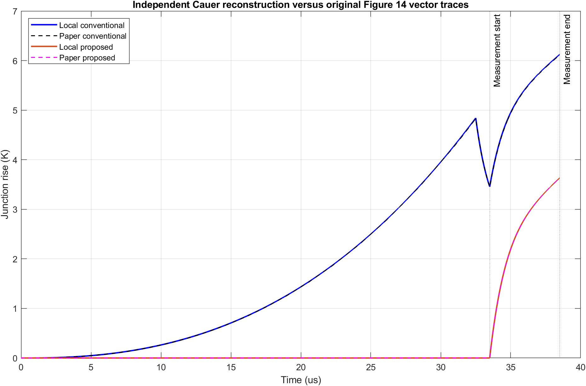
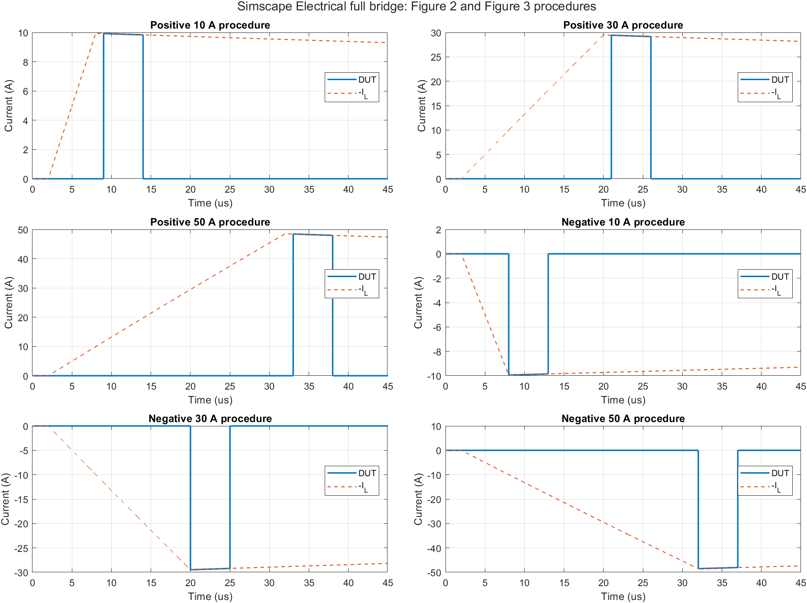

# GaN dynamic on-resistance: ECCE Europe 2024 reproduction

MATLAB / Simulink / Simscape Electrical 与 LTspice 的可运行复现工程，覆盖公开论文的电路机制、温控、静态与动态导通电阻图线、自热及模块联动。

An independent, executable simulation study of the public content of:

**P. Swoboda, S. R. Frank, A. Liske, and M. Hiller, “Improved Test Circuit for Characterization of the Dynamic On-Resistance of GaN-HEMTs over a Wide Operating Range,” IEEE ECCE Europe 2024.**

[Original paper DOI](https://doi.org/10.1109/ECCEEurope62508.2024.10751914) · [Author-accepted full text at KIT](https://publikationen.bibliothek.kit.edu/1000176527) · [13-page reproduction report (Chinese)](outputs/full_reproduction/GaN_ECCE2024_全篇仿真复现报告.pdf)

This is an independent reproduction, not the authors' original project. The native models were actually executed; the fitted resistance curves are **public-curve reconstructions**, not independent hardware measurements or a recovered proprietary GaN compact model.

## What is included

| Paper content | Implementation | Evidence |
|---|---|---|
| Figures 1–4: bridge, signed current and idle states | Native SPS full bridge, ±10/30/50 A, upper/lower idle | LTspice comparison, RLC/KVL checks |
| Figure 3: reverse current sharing | 72-condition continuous circuit model | Simulink and LTspice branch-current comparison |
| Figures 5–6: voltage clamp and measurement | Editable ASC, nonlinear representative Si-MOS models, two Simulink state models | ±5 V transfer, gate interlock, recovery and range budget |
| Figure 7: thermal control | Native Peltier conserving ports, two Buck filters, PWM and cascaded PI | Independent six-state ODE and energy checks |
| Figures 8–9: physical system | Documented electrical, measurement and thermal connections | Structural audit; hardware was not fabricated |
| Figures 10–12: static/dynamic resistance | Three native SLX models and 22 digitized public curves | Whole-temperature / blocked-time holdouts |
| Figures 13–14: pulse self-heating | LTspice, native four-stage Cauer, exact state integration | Original-curve comparison and independent integration |
| Cross-module behavior | Six stress/temperature/polarity snapshots | Measured V/I → pulse power → native Cauer |

There are **11 editable SLX models**, five representative native ASC schematics, reproducible builders, calibrated parameters, selected input/reference CSVs, metrics, and generated figures. Large RAW, MAT and FIG outputs are regenerated locally and are not committed.

## Run the native Simulink models

Verified environment: **Windows, MATLAB R2022b, Simulink, Simscape and Simscape Electrical; LTspice 24.0.12**. These commercial tools and their licenses are not included. Other releases have not been validated.

In MATLAB, enter `outputs/full_reproduction` and run:

```matlab
run_all       % Rebuild and actually simulate all 11 native models
open_models   % Open the bridge, wide-range clamp and thermal-control models
```

The saved model parameters and required reference data are included. The main MATLAB run does not require Python or a network connection. Rebuilding overwrites this project's generated models and results; save your own edits first.

From PowerShell 7:

```powershell
.\outputs\full_reproduction\开始复现.ps1 -Mode Simulink `
  -MatlabPath 'C:\Program Files\MATLAB\R2022b\bin\matlab.exe'
```

For all LTspice and MATLAB stages, obtain the external vendor models first, then run:

```powershell
python tools/fetch_external.py --models
.\outputs\full_reproduction\开始复现.ps1 -Mode All `
  -MatlabPath 'C:\Program Files\MATLAB\R2022b\bin\matlab.exe' `
  -LTspicePath 'C:\Program Files\ADI\LTspice\LTspice.exe'
```

Use your installed executable paths. The launcher runs LTspice jobs serially and leaves pre-existing application sessions alone. `-Mode Check`, `-Mode LTspice` and `-Mode Open` are also supported. The repository keeps `outputs/full_reproduction` and `outputs/reproduction` as siblings because the integration uses the earlier Cauer implementation.

The optional `python tools/fetch_external.py --paper` obtains the public author-accepted manuscript from KIT for coordinate extraction. Install `outputs/full_reproduction/ron_trapping/requirements-refit.txt` only if rerunning that optional fitting step. Vendor files and the manuscript remain under their owners' terms and are excluded from Git.

## Results and limits

- On 2026-10-02 the unified launcher completed **40 LTspice jobs and nine MATLAB execution/check stages**. All **11 saved SLX models** also reached their requested stop times when directly simulated in a fresh MATLAB process. Twelve additional LTspice jobs examined clamp edge sensitivity. See [execution evidence](docs/validated-run.json) and [native logs](docs/native_execution).
- Main-bridge measurement-platform currents differ from the independent LTspice baseline by approximately **0.17% RMS**. The 5 ns / 2.5 ns charge-current comparison differs by at most 6.35 mA.
- The native Cauer peaks are **6.123 K / 3.632 K**. Averaging over the full **33.5–38.5 µs** interval gives **5.237 K / 2.527 K**, a **51.74%** reduction. The published vector curves give approximately 51.75%. This does not reproduce the paper's 62% annotation; the authors' averaging procedure was not supplied.
- The independent thermal-control ODE agrees with native Simscape within **5.68e-5 K** over the logged trajectory, under explicitly assumed thermal and control parameters.
- Static Ron whole-temperature holdout RMSE is **0.4907 mΩ**. Dynamic-curve holdout errors measure reconstruction of published curves, not independent physical prediction.
- Native clamp ASC/CIR topology and measurement-window transfer agree. **Pointwise switching-edge convergence is not established**: baseline local differences reach 1.24 V; 50 ps / Gear checks retain about 0.5 V local differences. Failed whole-trace checks remain recorded. Do not treat these very short spikes as validated hardware SOA or exact oscilloscope recovery predictions.
- The authors' clamp BOM, PCB parasitics, raw noise samples and Table I's 20 hardware repetitions are unavailable. These experiments were not recreated. The TEC heatsink and installation parameters, fixed-Ron switching elements and calibrated trapping extension are documented assumptions.





## Repository checks

```bash
python tools/validate_repository.py
```

This checks the published source inventory, SLX containers, input data, scientific result bounds and explicit limitations. GitHub CI runs these portable checks; it does **not** claim to run licensed MATLAB or LTspice. [Native model validation](tools/validate_native_models.m) is available for a licensed local MATLAB environment.

Detailed assumptions are in each module's `README` and `MODEL_CARD`, the [coverage matrix](outputs/full_reproduction/audit/coverage_matrix.csv), and the [audit](outputs/full_reproduction/audit/AUDIT.txt). Some provenance hashes refer to locally generated or externally downloaded files; they document an execution snapshot, not bundled third-party artifacts.

## License and attribution

Original code, authored model structures and documentation are released under the [MIT License](LICENSE). This license does not grant rights to the paper, vendor models, datasheets or commercial simulators. Third-party files are not included; see [THIRD_PARTY.md](THIRD_PARTY.md). Public-curve coordinates and paper-reported values retain explicit source attribution and must not be described as new measurements.

Please cite both the original paper and this independent repository when using the work. No affiliation with or endorsement by the paper's authors, KIT, IEEE, MathWorks or the device vendors is implied.
